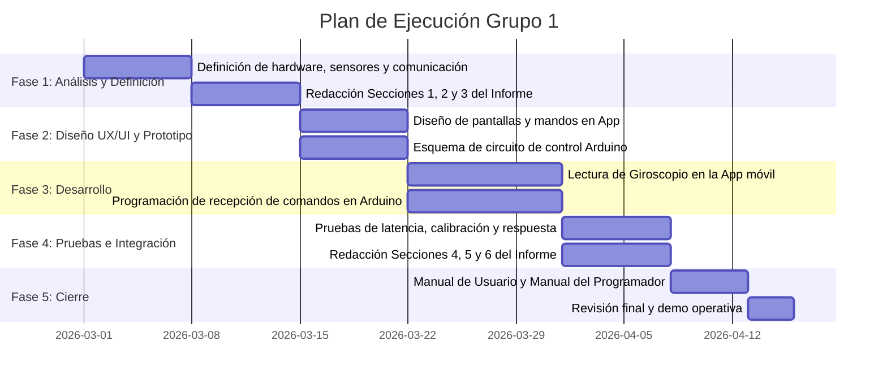

# Plan de Organización y Requisitos - Grupo 1
**Proyecto:** Auto y Dron con Control Remoto  
**Integrantes:** Onesti, Silvero, Mendieta  
**Materia:** Programación 7° Año (Prof. Figueroa Hernán - Prof. Piris Eduardo)  
**Ciclo Lectivo:** 2026  

---

## 1. Alcance y Definición del Proyecto (Grupo 1)

Según la asignación oficial:
* **Auto a control remoto:** Controlado con Arduino mediante **gestos y giroscopio**.
* **Dron:** Controlado mediante **aplicación móvil** con interfaz en pantalla (joystick/botones) y modo **giroscopio** (inclinación del teléfono).
* **Integración institucional:** Participación en el proyecto colaborativo **GEdeCon**.

---

## 2. Requisitos y Criterios Críticos de Evaluación

> **Advertencia (Condiciones Obligatorias para Aprobar):**
> * Uso obligatorio de al menos un **sensor real del teléfono** (en nuestro caso: **Giroscopio** y **Acelerómetro** del móvil).
> * Aplicación funcional, operable y sin errores en dispositivo real.
> * Código modular, limpio, organizado en capas/componentes y con comentarios explicativos.
> * Entrega de documentación completa y a tiempo.

### Criterios de Calificación
1. **Comprensión del problema:** Justificación de la necesidad o utilidad del control remoto mediante sensores.
2. **Calidad de la solución:** Robustez, fluidez y respuesta del control entre el teléfono y el Arduino/Dron.
3. **Uso correcto de sensores:** Lectura y calibración precisa de los ejes del giroscopio/acelerómetro del móvil.
4. **Funcionamiento y usabilidad de la App:** Interfaz UX/UI moderna, intuitiva y funcional.
5. **Estructura y calidad del código:** Modularidad, separación lógica (sensores, comunicación, UI).
6. **Documentación:** Informe final completo de 6 secciones + Manual de Usuario + Manual del Programador.

---

## 3. Estructura de Entregables

### A. Documentación Obligatoria (Informe Final)
* **Sección 1: Comprensión:** Contexto, problema a resolver y justificación del uso de control por sensores móviles.
* **Sección 2: Análisis:** Comparación de tecnologías, alternativas de sensores, protocolos de comunicación (Bluetooth / Wi-Fi) y microcontroladores (Arduino Uno/Nano/ESP32).
* **Sección 3: Propuesta:** Descripción detallada del sistema integral (Auto + Dron + App Móvil).
* **Sección 4: Diseño UX/UI:** Diagramas de flujo de pantallas, paleta de colores, wireframes y capturas de la interfaz final.
* **Sección 5: Desarrollo y Pruebas:** Arquitectura del software, pruebas de latencia, calibración de ejes de sensores y manejo de fallos de conexión.
* **Sección 6: Sensores (OBLIGATORIA):** Detalle técnico de la API del sensor móvil utilizado, fórmulas matemáticas (inclinación Roll/Pitch), muestreo y mapeo de datos enviados a los actuadores.

### B. Manuales Técnicos
1. **Manual de Usuario:** Guía clara con capturas de pantalla sobre cómo instalar la app, conectar con el auto/dron y calibrar el giroscopio.
2. **Manual del Programador:** Explicación técnica de la estructura de carpetas, dependencias, protocolos de comunicación serial/inalámbrica y cómo compilar/mantener el código.

### C. Software y Firmware
* Aplicación móvil para Android/iOS (Web App PWA o nativa/híbrida con acceso a API de sensores).
* Códigos Arduino/ESP32 (.ino / .cpp) comentados para la recepción de comandos y control de motores/servos.

---

## 4. Sugerencia de División de Roles en el Equipo

Para trabajar en paralelo y no retrasarse:

| Integrante | Rol Principal | Tareas Clave |
| :--- | :--- | :--- |
| **Mendieta** | **Líder de Software Móvil / UX-UI** | Desarrollo de la App móvil, interfaz visual, captura y procesamiento del Giroscopio/Acelerómetro en el smartphone. |
| **Silvero** | **Hardware y Firmware (Arduino / Dron)** | Montaje de circuitos, puente H (L298N/motores), conexión Bluetooth/Wi-Fi (HC-05 o ESP32) y programación del código Arduino. |
| **Onesti** | **Integración, Pruebas y Documentación** | Pruebas de comunicación App-Hardware, calibración de gestos, redacción del Informe (6 secciones) y Manuales de Usuario/Programador. |

*(Los roles son colaborativos: todos deben conocer el funcionamiento general para la defensa).*

---

## 5. Plan de Trabajo por Fases (Cronograma Recomendado)

---

## 6. Próximos Pasos para Iniciar
1. Definir la tecnología de la App móvil (ej. HTML5/JavaScript moderno empaquetado/PWA o React Native / Flutter).
2. Definir el módulo de comunicación inalámbrica con el Arduino (Bluetooth HC-05/06 o ESP32 por Wi-Fi/WebSockets).
3. Crear el borrador de la estructura de carpetas en este repositorio.
